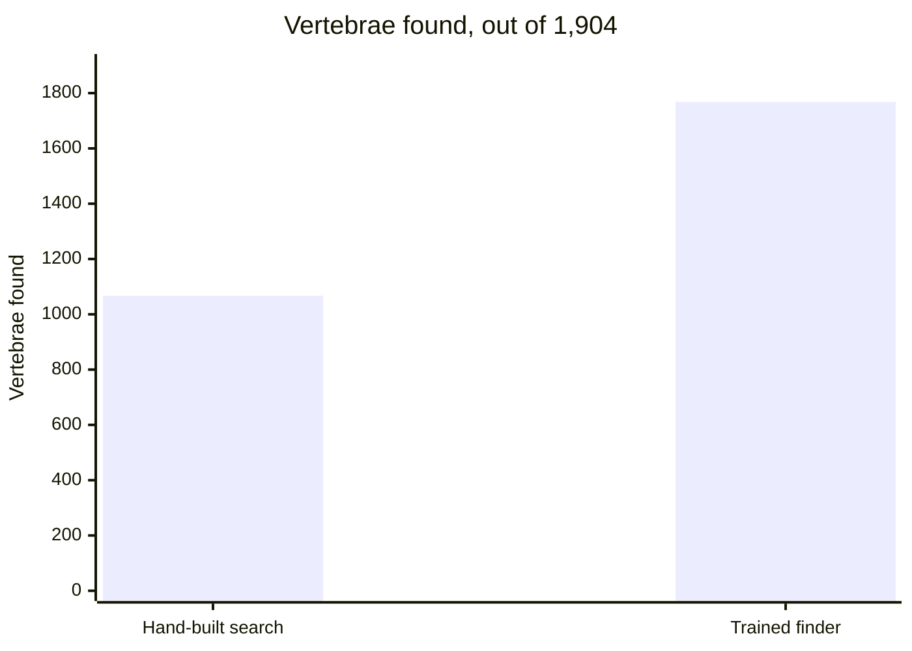
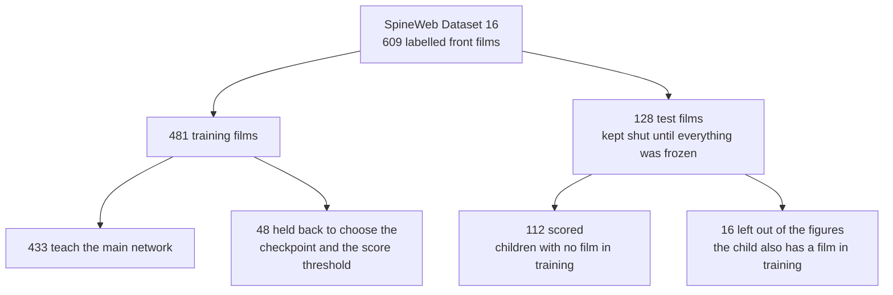
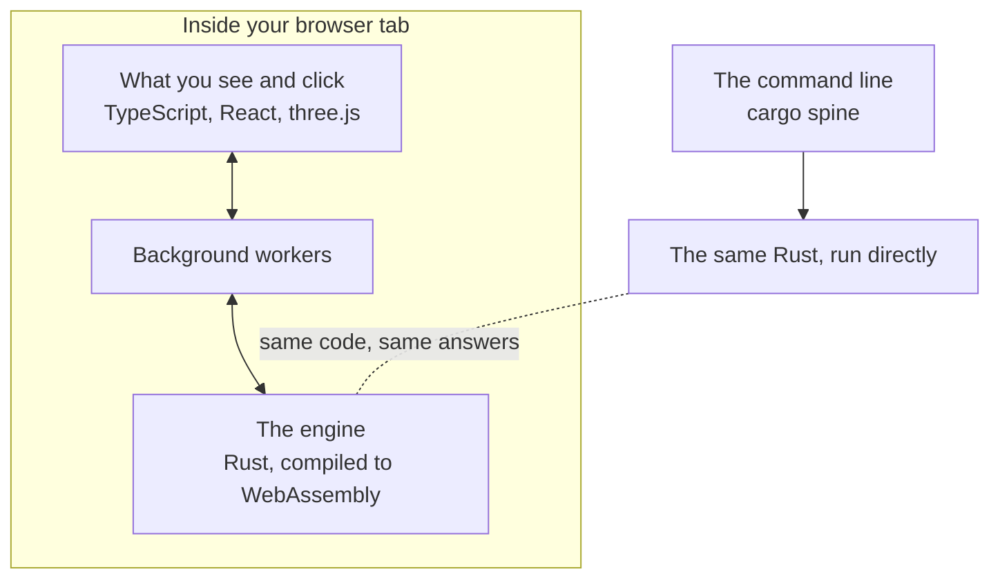
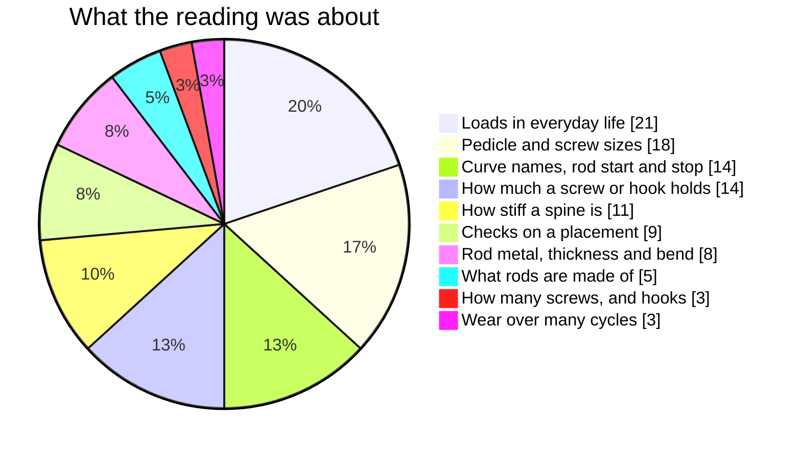

# Spine Workbench

**Turn a few spine X-rays into a 3D spine you can spin around, measure, and try screws and rods on. It runs in your browser, and nothing ever leaves your computer.**

[](https://youtu.be/yQ46uTyfzfo)

<p align="center"><a href="https://youtu.be/yQ46uTyfzfo">▶ Watch the demo on YouTube</a></p>

> **Please read this bit first.** Spine Workbench shows previews with error bands. It does not predict any patient's outcome. It is not a medical device and is not validated for clinical use. It is a project for learning and research, and a surgeon decides.

## The problem, in plain words

Scoliosis is a spine that curves sideways and twists at the same time. When a child's curve gets big enough, surgeons straighten it by putting screws into the vertebrae (the bones of the spine) and joining them with two metal rods.

Before that operation, somebody has to work out three things:

- which vertebrae the rods should start and stop at,
- where each screw goes and how big it should be,
- how the rods should bend.

Most of that thinking is done on flat X-rays. Here is why that is hard.

**A flat picture hides a 3D shape.** In a study of 120 teenagers, the rounding of the upper back measured 18° on the ordinary side X-ray. Measured in true 3D, it was 6°. The twist in the spine fools the flat picture ([Newton and others, 2015](https://pubmed.ncbi.nlm.nih.gov/26491134/)).

**Measuring by hand wobbles.** When five people measured the same X-rays twice, a curve had to change by about 10° before anyone could be 95% sure the change was real and not just the measuring ([Carman and others, 1990](https://pubmed.ncbi.nlm.nih.gov/2312528/)).

**Surgeons looking at the same X-rays choose differently.** Thirty-two experienced surgeons from 15 countries were each asked to plan the same 12 cases. Where the rods should start differed by up to 10 vertebrae on one kind of curve, and where they should stop differed by up to 5 ([Wilke and others, 2024](https://europepmc.org/article/PMC/PMC11022599)). An older study with six surgeons and five patients found the same kind of spread ([Aubin and others, 2007](https://pubmed.ncbi.nlm.nih.gov/16477449/)).

**Even careful computer models miss by a few degrees.** A research simulator, checked against 10 real operations, came out 3.5° to 4.7° away from the real result on average ([Aubin and others, 2008](https://pubmed.ncbi.nlm.nih.gov/18794755/)). So a tool that prints one confident number is saying more than anyone knows.

And surgeons have said they want help. In a 2025 survey of AO Spine members, with 399 replies, "prediction algorithms" were a top research priority for 69%, and fitting new tools into the working day was one of the main things in the way ([Morawska and others, 2026](https://pubmed.ncbi.nlm.nih.gov/42664305/)).

So I asked a simple question. Could a free tool, in a browser tab, turn ordinary X-rays into a 3D spine, say plainly how sure it is, and show where every number came from?

## What I built

A browser app with four steps. You can stop after any of them.


| Step | What happens |
|---|---|
| **1. Films** | Drop in up to four X-rays of one child: standing from the front, standing from the side, bending left and bending right. It reads PNG, JPEG and hospital DICOM files. The front film on its own is enough to carry on. |
| **2. Find** | Press one button and watch. The app sweeps down each film, draws an outline round every vertebra and names it, from T1 at the top to L5 at the bottom. Anything it is unsure about gets an amber "needs a look". |
| **3. 3D** | All the outlines are fitted at once into a single 3D spine made of real bone shapes. Turn it, look at it from three sides, and read the measurements: the angle of each curve, the rounding of the upper back, the arch of the lower back and the twist at the peak of the curve. Each one comes with its band, like `40° ± 4°`. |
| **4. Place** | The app draws a first placement on that spine: where the rods start and stop, the screws and hooks, a size for each screw, and two rods. Change anything by hand, with undo. Then put it under load and step through five stops: Before, Rods in, Standing, Bending forward and A year of walking. |

You can save a case as one file and open it again later.

Three things I would not bend on:

- **Your films stay with you.** There is no server behind it, no upload and no account. Once the page has loaded, the app never reaches outside itself. A browser rule blocks it, a code rule bans it, and a test fails if a single request leaves the machine.
- **It says how sure it is.** Measurements carry a band. Shaky outlines are flagged for a person to check. When the films cannot answer a question, the app says it cannot tell. With only a front film, it says the depth and side curve are typical values, not measured ones.
- **Every number has a home.** Screw sizes, rod choices and loads come from published tables, and the app shows the source beside the part. The full reading list is [further down](#where-everything-comes-from).

### How Place makes up its mind

Nobody knows a spine exactly from an X-ray. So the app does not pretend to. It makes 32 slightly different versions of the same spine, each one a fair reading of the films, and asks the same questions of all of them.

For where the rods should start and stop, it runs a dozen published rules on every version and counts how often each rule gives each answer. When the rules disagree, the disagreement stays on screen. When a rule cannot be read from these films, the app says so and that rule gets no vote.

The load step works the same way. It seats the rods, locks the screws, lets go, and then adds everyday loads, across those same versions. What comes out is a range and a count, never a single promise, and never a forecast of how long anything will last.

## How well does the finder do?

Everything hangs on step 2. If the vertebrae are found in the wrong places, the 3D spine is wrong too.

My first finder was built by hand, with no training at all. On real films it found a bit over half the vertebrae. So I trained a small network, then wrote it out by hand in Rust so it runs inside the engine with nothing extra to download.

Here are both, on 112 test films from children whose films the network never saw in training. That is 1,904 labelled vertebrae.



| On the 112 films | Trained finder | Hand-built search |
|---|---:|---:|
| vertebrae found | 1,768 of 1,904 (92.9%) | 1,067 of 1,904 (56.0%) |
| outlines drawn on nothing | 136 | 950 |
| films with all 17 found and in order | 44 of 112 | 0 of 112 |
| how far a corner lands from its label, middle value, as a share of the vertebra's height | 0.12 | 0.26 |

The test was run once. The code, settings and weights were frozen, and their fingerprints written down, before the test films were opened.

Where it still trips up:

- **Names are estimates.** On about 40 of the 112 films the whole stack is named one level too high. The app says so on screen and asks you to check where T1 is.
- **Hard films.** Braces, metalwork, soft or narrow films, and necks or hips in view all cause missed vertebrae and outlines on nothing.
- **One hospital.** It was trained and tested on films from one hospital's collection. How it does elsewhere is not known.

The whole story, with every figure and every limit, is in [`engine/trained-finder/README.md`](engine/trained-finder/README.md).

### What it learned from

The network learned from the labelled front films of SpineWeb Dataset 16, as released for the [AASCE 2019 challenge](https://aasce19.grand-challenge.org/). No ready-made model was used as a starting point. The films are not in this repository, and the training code is not either.



## How it is built



- **Rust does the computing.** It is compiled to WebAssembly and runs in background workers, so the page never freezes while it thinks.
- **TypeScript and React do everything you see and click.** [three.js](https://threejs.org/) draws the 3D spine.
- **The same Rust also runs from the command line.** That lets every calculation be tested on made-up spines first. The engine can paint a fake X-ray of a spine whose true shape it already knows, then check that it gets that shape back.
- **The trained finder is plain Rust too.** Its weights, about 2.7 million numbers, are compiled into the engine. There is no machine-learning library and nothing is fetched.
- **The bones are real shapes.** They come from [BodyParts3D](https://dbarchive.biosciencedbc.jp/en/bodyparts3d/desc.html), an open anatomy set. Each bone is shaped to its fitted vertebra. They are one adult's bones, never the patient's own.

## Run it

You need [rustup](https://rustup.rs), Node 22.13 or later and pnpm 9.12 or later. Then, from the repository root:

```sh
cargo install wasm-bindgen-cli --version 0.2.130 --locked
pnpm install
pnpm dev
```

The first command installs the tool that turns the Rust engine into a module the browser can load. Its version must match the `wasm-bindgen` crate, and a bare version installs exactly that one. The pinned Rust toolchain installs itself the first time cargo runs. `pnpm dev` builds the engine and serves the app at http://localhost:5173.

One thing to know: in development the app starts with a stand-in engine and a made-up sample case, so the screens can be looked at quickly. To read your own films, open http://localhost:5173/?engine=real. A production build always uses the real engine.

The browser tests need Playwright's Chromium, installed once:

```sh
pnpm --filter ./proving-ground exec playwright install chromium
```

Other commands:

| Command | Does |
|---|---|
| `pnpm build` | the production app in `app/dist/` |
| `pnpm verify` | the checks CI runs: types and lints, unit tests, then browser tests on the production build, in Chromium only (CI adds WebKit) |
| `cargo spine <command>` | the same engine on the command line |

The production build is a static site. Serve it with the `Content-Security-Policy` header set to `CONTENT_POLICY_HEADER` from `app/build-plugins/content-policy.ts` on every file, as `pnpm --filter ./app preview` does: the app's workers take their policy from that header.

## What it cannot do

- **It is not a medical device** and is not validated for clinical use. It shows previews with error bands, not predictions.
- **One front film only goes so far.** Depth, the side curve and twist are then typical values from published groups of people, not measurements of this child.
- **Sizes come from tables.** A screw size in Place describes a population of children in a published study. It is not read from this child's bones.
- **Loads are estimates in a simple model.** The load step models no muscles, and its absolute forces rest on assumptions. Read the ranges and counts, not single figures.
- **The bones are borrowed.** The 3D spine is drawn with one adult's bone shapes, fitted to the outlines. It is not a scan of the patient.
- **You cannot yet fix an outline by hand.** The maths for the correcting tools is in the engine. The screen for them is not built.
- **A placement is not saved with the case.** Films, outlines and names are.

## Where everything comes from

I read a lot for this, and I wanted all of it to be checkable. Each source below is linked. Inside the repository, every number also records which paper it came from, where in the paper, and how much of the paper was read (the full text, or only the summary).

### The X-rays the finder learned from

- **The films:** SpineWeb Dataset 16, as released for the [AASCE 2019 challenge](https://aasce19.grand-challenge.org/). The folder layout the code reads is the `boostnet_labeldata` folder of [this public mirror](https://github.com/zlinzju/ke30_u7_AASCE2019).
- **The credit the dataset asks for:** Wu H, Bailey C, Rasoulinejad P, Li S (2017). [Automatic landmark estimation for adolescent idiopathic scoliosis assessment using BoostNet](https://doi.org/10.1007/978-3-319-66182-7_15). *MICCAI 2017*, pages 127 to 135.
- **More in the repository:** [what the weights are and what they were trained on](engine/trained-finder/weights/README.md), [what the labels look like](proving-ground/datasets/aasce-2019.md), and [why a trained finder was chosen](docs/decisions/a-trained-finder-for-front-films.md).

### The bones

- [BodyParts3D](https://dbarchive.biosciencedbc.jp/en/bodyparts3d/desc.html), release 4.0, the vertebrae from C7 to L5. *BodyParts3D, © The Database Center for Life Science licensed under CC Attribution 4.0 International.* Its [licence page](https://dbarchive.biosciencedbc.jp/en/bodyparts3d/lic.html).
- What was done to the shapes, which is very little: [`bone-prep/README.md`](bone-prep/README.md).

### The typical spine

A front X-ray cannot show how far each vertebra leans forward, how deep it is, or how much it is twisted. For those the app falls back on typical values, and says so. They come from these, described in [`bone-prep/typical-spine.md`](bone-prep/typical-spine.md):

| Source | What it gave |
|---|---|
| Burkus and others (2018). [Sagittal plane assessment of spino-pelvic complex in a Central European population with adolescent idiopathic scoliosis](https://doi.org/10.1186/s13013-018-0156-0). *Scoliosis Spinal Disord*. | how much the upper back rounds and the lower back arches in young people |
| Sullivan and others (2020). [More severe thoracic idiopathic scoliosis is associated with a greater three-dimensional loss of thoracic kyphosis](https://doi.org/10.1007/s43390-020-00149-7). *Spine Deform*. | how the upper back flattens as the curve gets bigger, in 3,032 patients |
| Newton and others (2015). [Defining the "three-dimensional sagittal plane" in thoracic adolescent idiopathic scoliosis](https://doi.org/10.2106/JBJS.O.00148). *J Bone Joint Surg Am*. | the true 3D rounding of the upper back in large curves |
| Mac-Thiong and others (2007). [Sagittal spinopelvic balance in normal children and adolescents](https://doi.org/10.1007/s00586-005-0013-8). *Eur Spine J*. | how the spine leans in 341 children without scoliosis |
| József and others (2022). [Maximal axial vertebral rotation in adolescent idiopathic scoliosis: is the apical vertebra the most rotated?](https://doi.org/10.1177/2192568220948830) *Global Spine J*. | the typical twist at the peak of a curve, by curve size |
| Pan and others (2021). [Morphologic analysis of Chinese lumbar endplate by three-dimensional computed tomography reconstructions for helping design lumbar disc prosthesis](https://doi.org/10.1097/MD.0000000000024583). *Medicine (Baltimore)*. | how deep a vertebra is compared with how wide it is |
| Busscher and others (2010). [Comparative anatomical dimensions of the complete human and porcine spine](https://doi.org/10.1007/s00586-010-1326-9). *Eur Spine J*. | how much the height of a vertebra varies from person to person |

### Measuring a curve

- Negrini and others (2018). [2016 SOSORT guidelines: orthopaedic and rehabilitation treatment of idiopathic scoliosis during growth](https://pmc.ncbi.nlm.nih.gov/articles/PMC5795289/). *Scoliosis Spinal Disord*. This is where the 10° floor for calling something a curve comes from.
- How every angle is defined, and which way is positive: [`engine/spine-readings/README.md`](engine/spine-readings/README.md).

### Screws, rods and loads

This is the big pile: 106 published sources behind Place and the load step. Each is filed under the first job it does, and most do more than one.



Open a heading to see its papers.

<details>
<summary><b>Naming the curve, and where the rods start and stop</b> (14)</summary>

- AO Surgery Reference. [Lenke classification](https://surgeryreference.aofoundation.org/spine/deformities/adolescent-idiopathic-scoliosis/further-reading/lenke-classification).
- Banno et al. (2023). [Preoperative Less Right Shoulder Elevation Had a Higher Risk of Postoperative Shoulder Imbalance When Main Thoracic Curve Shows Higher Correction Regardless of the Upper Instrumented Vertebra Level for Patients with Adolescent Idiopathic Scoliosis Lenke Type 1](https://europepmc.org/abstract/MED/36138576). *Asian Spine J*.
- Banno et al. (2025). [Residual T1 tilt could lead to poor self-image for patients with Lenke type 1 adolescent idiopathic scoliosis](https://europepmc.org/abstract/MED/39658742). *Spine Deform*.
- Chen et al. (2026). [Advances in fusion level selection and surgical approaches for adolescent idiopathic scoliosis based on the Lenke classification system: a narrative review](https://europepmc.org/article/PMC/PMC12870182). *BMC Surg*.
- Chen et al. (2026). [Lowest Instrumented Vertebra (LIV) Index as a Supplemental Indicator to Lastly Touched Vertebra for Selection of the Fusion Level in Main Thoracic Adolescent Idiopathic Scoliosis](https://europepmc.org/article/PMC/PMC12361177). *Global Spine J*.
- Hori et al. (2025). [Optimal Selection of Lower Instrumented Vertebra Can Minimize Distal Junctional Kyphosis After Posterior Spinal Fusion for Thoracic Adolescent Idiopathic Scoliosis](https://europepmc.org/abstract/MED/40103372). *Spine (Phila Pa 1976)*.
- Kim et al. (2021). [Selection of Fusion Level for Adolescent Idiopathic Scoliosis Surgery : Selective Fusion versus Postoperative Decompensation](https://europepmc.org/article/PMC/PMC8273784). *J Korean Neurosurg Soc*.
- Lenke et al. (2001). [Adolescent idiopathic scoliosis: a new classification to determine extent of spinal arthrodesis](https://europepmc.org/abstract/MED/11507125). *J Bone Joint Surg Am*.
- Liu et al. (2020). [Selection of the Lowest Instrumented Vertebra and Relative Odds Ratio of Distal Adding-on for Lenke Type 1A and 2A Curves in Adolescent Idiopathic Scoliosis: A Systematic Review and Meta-analysis](https://europepmc.org/article/PMC/PMC7788412). *Neurospine*.
- Ohrt-Nissen et al. (2026). [The S1-LIV angle is essential for fusion selection in thoracic adolescent idiopathic scoliosis - a dual-center machine learning study with external validation](https://europepmc.org/abstract/MED/42811138). *Eur Spine J*.
- Qin et al. (2019). [Where to stop distally in Lenke modifier C AIS with lumbar curve more than 60°: L3 or L4?](https://europepmc.org/abstract/MED/30739071). *Clin Neurol Neurosurg*.
- Studer et al. (2015). [Selective fusion in adolescent idiopathic scoliosis: a radiographic evaluation of risk factors for imbalance](https://europepmc.org/article/PMC/PMC4417731). *J Child Orthop*.
- Wang et al. (2023). [Distal Junctional Kyphosis after Posterior Spinal Fusion in Lenke 1 and 2 Adolescent Idiopathic Scoliosis-Exploring Detailed Features of the Sagittal Stable Vertebra Concept](https://europepmc.org/abstract/MED/34096362). *Global Spine J*.
- Zhao et al. (2024). [Systematic review and meta-analysis for the proximal junctional kyphosis in adolescent idiopathic scoliosis](https://europepmc.org/article/PMC/PMC11350560). *Front Pediatr*.

</details>

<details>
<summary><b>How big a pedicle is, and which screw fits it</b> (18)</summary>

- Akazawa et al. (2015). [Evaluation of pedicle screw placement by pedicle channel grade in adolescent idiopathic scoliosis: should we challenge narrow pedicles?](https://europepmc.org/abstract/MED/26124077). *J Orthop Sci*.
- Balikci et al. (2019). [Mid-length Pedicle Screws in Posterior Instrumentation of Scoliosis](https://europepmc.org/article/PMC/PMC6773991). *Asian Spine J*.
- Chiu et al. (2024). [The widths of the medial and lateral pedicle walls in adolescent idiopathic scoliosis with major thoracic curves](https://europepmc.org/abstract/MED/38408520). *Spine J*.
- Gao et al. (2017). [What is the Difference in Morphologic Features of the Thoracic Pedicle Between Patients With Adolescent Idiopathic Scoliosis and Healthy Subjects? A CT-based Case-control Study](https://europepmc.org/article/PMC/PMC5638737). *Clin Orthop Relat Res*.
- Grabala et al. (2023). [Influences of Increasing Pedicle Screw Diameter on Widening Vertebral Pedicle Size during Surgery in Spinal Deformities in Children and Adolescents without Higher Risk of Pedicle and Vertebral Breaches](https://europepmc.org/article/PMC/PMC10455094). *J Clin Med*.
- Jiang et al. (2022). [Accuracy of thoracic pedicle screw placement in adolescent idiopathic scoliosis patients using the entry point identified by new landmarks: a computed tomography study](https://europepmc.org/article/PMC/PMC9636753). *BMC Surg*.
- Katsumi et al. (2025). [Accuracy and deviation risk factors of pedicle screws in AIS surgery using intraoperative CT-based navigation: a retrospective study of 1,082 screws](https://europepmc.org/abstract/MED/40856839). *Eur Spine J*.
- Kuraishi et al. (2013). [Pedicle morphology using CT-based navigation system in adolescent idiopathic scoliosis](https://europepmc.org/article/PMC/PMC3675381). *Scoliosis*. (the meeting abstract of the same work)
- Kuraishi et al. (2013). [Pedicle morphology using computed tomography-based navigation system in adolescent idiopathic scoliosis](https://pubmed.ncbi.nlm.nih.gov/21959835/). *J Spinal Disord Tech*.
- Misenhimer et al. (1989). [Anatomic analysis of pedicle cortical and cancellous diameter as related to screw size](https://europepmc.org/abstract/MED/2718038). *Spine (Phila Pa 1976)*.
- Pluemvitayaporn et al. (2025). [Pedicle Morphology Analysis in Adolescents with Lenke Type 5 Idiopathic Scoliosis in Thai Population](https://europepmc.org/article/PMC/PMC11875695). *Asian J Neurosurg*.
- Ramanathan et al. (2026). [O-arm navigation vs. freehand screw placement in adolescent idiopathic scoliosis: A comparative analysis of screw size and reoperation rates](https://europepmc.org/article/PMC/PMC13295182). *Acta Orthop Traumatol Turc*.
- Sarwahi et al. (2017). [Pedicle Screw Safety: How Much Anterior Breach Is Safe?: A Cadaveric and CT-Based Study](https://europepmc.org/abstract/MED/28296814). *Spine (Phila Pa 1976)*.
- Sarwahi et al. (2023). [Effect of Pedicle Screw Size on Surgical Outcomes Following Surgery for 412 Adolescent Idiopathic Scoliosis Patients](https://europepmc.org/abstract/MED/37134132). *Spine (Phila Pa 1976)*.
- Sato et al. (2022). [Three-dimensional morphological analysis of the thoracic pedicle and related radiographic factors in adolescent idiopathic scoliosis](https://europepmc.org/article/PMC/PMC9450434). *BMC Musculoskelet Disord*.
- Ueno et al. (2025). [Factors causing deviation of robot-assisted pedicle screw placement for adolescent idiopathic scoliosis: why does deviation still occur even with robotics?](https://europepmc.org/abstract/MED/40299013). *Eur Spine J*.
- Upendra et al. (2010). [Pedicle morphometry in patients with adolescent idiopathic scoliosis](https://europepmc.org/article/PMC/PMC2856392). *Indian J Orthop*.
- Zheng et al. (2009). [Computed tomographic morphometry of thoracic pedicles: safety pedicle parameter measurement of the Chinese immature thoracic spine](https://europepmc.org/article/PMC/PMC2899159). *Int Orthop*.

</details>

<details>
<summary><b>How many screws, and hooks at the top</b> (3)</summary>

- Cammarata et al. (2014). [Biomechanical risk factors for proximal junctional kyphosis: a detailed numerical analysis of surgical instrumentation variables](https://europepmc.org/abstract/MED/24480964). *Spine (Phila Pa 1976)*.
- Larson et al. (2013). [Are More Screws Better? A Systematic Review of Anchor Density and Curve Correction in Adolescent Idiopathic Scoliosis](https://europepmc.org/abstract/MED/27927354). *Spine Deform*.
- Larson et al. (2024). [The Effect of Implant Density on Adolescent Idiopathic Scoliosis Fusion: Results of the Minimize Implants Maximize Outcomes Randomized Clinical Trial](https://europepmc.org/abstract/MED/37973031). *J Bone Joint Surg Am*.

</details>

<details>
<summary><b>Rods: metal, thickness and bend</b> (8)</summary>

- Abe et al. (2015). [Scoliosis corrective force estimation from the implanted rod deformation using 3D-FEM analysis](https://europepmc.org/article/PMC/PMC4331738). *Scoliosis*.
- Boissiere et al. (2023). [Rod Angulation Relationship with Thoracic Kyphosis after Adolescent Idiopathic Scoliosis Posterior Instrumentation](https://europepmc.org/abstract/MED/38255344). *Children (Basel)*.
- Borrelli et al. (2025). [Combined Rigid-Flexible Multibody Analysis Reveals Reduced Pedicle Screw Loads in Short-Segment Fixation for Decompressed Lumbar Spine Stabilization](https://europepmc.org/article/PMC/PMC12006242). *Ann Biomed Eng*.
- Cidambi et al. (2012). [Postoperative changes in spinal rod contour in adolescent idiopathic scoliosis: an in vivo deformation study](https://europepmc.org/abstract/MED/22426445). *Spine (Phila Pa 1976)*.
- Salmingo et al. (2014). [Influence of implant rod curvature on sagittal correction of scoliosis deformity](https://europepmc.org/abstract/MED/24275616). *Spine J*.
- Sia et al. (2019). [Post-implantation Deformation of Titanium Rod and Cobalt Chrome Rod in Adolescent Idiopathic Scoliosis](https://europepmc.org/article/PMC/PMC6459034). *Malays Orthop J*.
- Wang et al. (2016). [How does differential rod contouring contribute to 3-dimensional correction and affect the bone-screw forces in adolescent idiopathic scoliosis instrumentation?](https://europepmc.org/abstract/MED/27750078). *Clin Biomech (Bristol)*.
- Wilke et al. (2024). [Range of international surgical strategies for adolescent idiopathic scoliosis: Evaluation of a multi-center survey](https://europepmc.org/article/PMC/PMC11022599). *JOR Spine*.

</details>

<details>
<summary><b>Things to check on a placement</b> (9)</summary>

- Brooks et al. (2018). [In Search of the Ever-Elusive Postoperative Shoulder Balance: Is the T2 UIV the Key?](https://europepmc.org/abstract/MED/30348348). *Spine Deform*.
- Cerny et al. (2014). [The radiographic method for evaluation of axial vertebral rotation - presentation of the new method](https://doi.org/10.1186/1748-7161-9-11). *Scoliosis*.
- Cui et al. (2012). [Morphologic evaluation of the thoracic vertebrae for safe free-hand pedicle screw placement in adolescent idiopathic scoliosis: a CT-based anatomical study](https://europepmc.org/abstract/MED/21739245). *Surg Radiol Anat*.
- Etemadifar and Jamalaldini (2017). [Evaluating Accuracy of Free-hand Pedicle Screw Insertion in Adolescent Idiopathic Scoliosis Using Postoperative Multi-Slice Computed Tomography Scan](https://europepmc.org/article/PMC/PMC5353768). *Adv Biomed Res*.
- Fennell et al. (2014). [Freehand thoracic pedicle screw technique using a uniform entry point and sagittal trajectory for all levels: preliminary clinical experience](https://europepmc.org/abstract/MED/25147977). *J Neurosurg Spine*.
- Lehman et al. (2003). [Straight-forward versus anatomic trajectory technique of thoracic pedicle screw fixation: a biomechanical analysis](https://europepmc.org/abstract/MED/14501914). *Spine (Phila Pa 1976)*.
- Peng et al. (2023). [Supraspinous ligament arc tangent guided freehand thoracic pedicle screw insertion technique: high parallelism between screws and upper endplate](https://www.frontiersin.org/articles/10.3389/fsurg.2023.1219816/full). *Front Surg*.
- Takeshita et al. (2010). [New parameters to represent the position of the aorta relative to the spine for pedicle screw placement](https://europepmc.org/abstract/MED/20127493). *Eur Spine J*.
- Wei Chan et al. (2025). [The Influence of Relative Curve Correction and Upper Instrumented Vertebra (UIV) Tilt Angle on Post-operative Shoulder Balance Following Posterior Spinal Fusion (PSF) in Lenke Type 1 and 2 Adolescent Idiopathic Scoliosis (AIS) Patients](https://europepmc.org/abstract/MED/40020691). *Global Spine J*.

</details>

<details>
<summary><b>How stiff a spine is</b> (11)</summary>

- Gardner-Morse and Stokes (2004). [Structural behavior of human lumbar spinal motion segments](https://europepmc.org/abstract/MED/14706323). *J Biomech*.
- Liebsch and Wilke (2020). [Rib Presence, Anterior Rib Cage Integrity, and Segmental Length Affect the Stability of the Human Thoracic Spine: An in vitro Study](https://europepmc.org/abstract/MED/32117927). *Front Bioeng Biotechnol*.
- Mannen et al. (2018). [The rib cage stiffens the thoracic spine in a cadaveric model with body weight load under dynamic moments](https://europepmc.org/abstract/MED/29852313). *J Mech Behav Biomed Mater*.
- Petit et al. (2004). [Patient-specific mechanical properties of a flexible multi-body model of the scoliotic spine](https://europepmc.org/abstract/MED/14977223). *Med Biol Eng Comput*.
- Salmingo et al. (2012). [Corrective force analysis for scoliosis from implant rod deformation](https://pubmed.ncbi.nlm.nih.gov/22321374/). *Clin Biomech (Bristol)*.
- Salmingo et al. (2013). [Relationship of forces acting on implant rods and degree of scoliosis correction](https://pubmed.ncbi.nlm.nih.gov/23273729/). *Clin Biomech (Bristol)*.
- Stokes and Gardner-Morse (2016). [A database of lumbar spinal mechanical behavior for validation of spinal analytical models](https://europepmc.org/abstract/MED/26900035). *J Biomech*.
- Tachi et al. (2021). [Surgical Outcome Prediction Using a Four-Dimensional Planning Simulation System With Finite Element Analysis Incorporating Pre-bent Rods in Adolescent Idiopathic Scoliosis: Simulation for Spatiotemporal Anatomical Correction Technique](https://europepmc.org/abstract/MED/34712654). *Front Bioeng Biotechnol*.
- Wang et al. (2017). [Biomechanical effect of pedicle screw distribution in AIS instrumentation using a segmental translation technique: computer modeling and simulation](https://europepmc.org/abstract/MED/28428982). *Scoliosis Spinal Disord*.
- Watkins et al. (2005). [Stability provided by the sternum and rib cage in the thoracic spine](https://europepmc.org/abstract/MED/15928553). *Spine (Phila Pa 1976)*.
- Wilke et al. (2017). [In vitro analysis of the segmental flexibility of the thoracic spine](https://europepmc.org/abstract/MED/28520819). *PLoS One*.

</details>

<details>
<summary><b>What rods are made of</b> (5)</summary>

- Jeong et al. (2025). [Simulation and validation of spinal construct testing based on ASTM F1717](https://europepmc.org/abstract/MED/41383715). *Front Bioeng Biotechnol*.
- Little et al. (2013). [An FE investigation simulating intra-operative corrective forces applied to correct scoliosis deformity](https://europepmc.org/abstract/MED/23680391). *Scoliosis*.
- Ohrt-Nissen et al. (2018). [Choice of Rods in Surgical Treatment of Adolescent Idiopathic Scoliosis: What Are the Clinical Implications of Biomechanical Properties? - A Review of the Literature](https://europepmc.org/abstract/MED/29991241). *Neurospine*.
- Prasad et al. (2017). [Metallic Biomaterials: Current Challenges and Opportunities](https://europepmc.org/abstract/MED/28773240). *Materials (Basel)*.
- Song et al. (2021). [Stress distribution of different lumbar posterior pedicle screw insertion techniques: a combination study of finite element analysis and biomechanical test](https://europepmc.org/abstract/MED/34155224). *Sci Rep*.

</details>

<details>
<summary><b>How much a screw or hook holds</b> (14)</summary>

- Cheng et al. (2000). [Generalized low areal and volumetric bone mineral density in adolescent idiopathic scoliosis](https://europepmc.org/abstract/MED/10934658). *J Bone Miner Res*.
- Kang et al. (2014). [Pedicle screw "hubbing" in the immature thoracic spine: a biomechanical and micro-computed tomography evaluation](https://europepmc.org/abstract/MED/24590340). *J Pediatr Orthop*.
- Karami et al. (2015). [Biomechanical evaluation of the pedicle screw insertion depth effect on screw stability under cyclic loading and subsequent pullout](https://europepmc.org/abstract/MED/25310387). *J Spinal Disord Tech*.
- Kueny et al. (2014). [Influence of the screw augmentation technique and a diameter increase on pedicle screw fixation in the osteoporotic spine: pullout versus fatigue testing](https://europepmc.org/abstract/MED/25082759). *Eur Spine J*.
- Le Cann et al. (2015). [Pedicle Screw Fixation Study in Immature Porcine Spines to Improve Pullout Resistance during Animal Testing](https://europepmc.org/abstract/MED/26451947). *PLoS One*.
- Liljenqvist et al. (2001). [Pullout strength of pedicle screws versus pedicle and laminar hooks in the thoracic spine](https://europepmc.org/abstract/MED/11383294). *Acta Orthop Belg*.
- Sairyo et al. (1998). [Neurocentral synchondrosis fracture in immature spines associated with pedicle screw type fixation devices](https://europepmc.org/abstract/MED/9588471). *J Spinal Disord*.
- Santoni et al. (2009). [Cortical bone trajectory for lumbar pedicle screws](https://europepmc.org/abstract/MED/18790684). *Spine J*.
- Sariyilmaz et al. (2021). [Direct vertebral rotation significantly decreases the pullout strength of the pedicle screw: a biomechanical study in adult cadavers](https://europepmc.org/abstract/MED/32453125). *J Pediatr Orthop B*.
- Soshi et al. (1991). [An experimental study on transpedicular screw fixation in relation to osteoporosis of the lumbar spine](https://europepmc.org/abstract/MED/1750009). *Spine (Phila Pa 1976)*.
- Tsai et al. (2009). [Comparison and prediction of pullout strength of conical and cylindrical pedicle screws within synthetic bone](https://europepmc.org/abstract/MED/19402917). *BMC Musculoskelet Disord*.
- Weiser et al. (2017). [Insufficient stability of pedicle screws in osteoporotic vertebrae: biomechanical correlation of bone mineral density and pedicle screw fixation strength](https://europepmc.org/abstract/MED/28391382). *Eur Spine J*.
- Yilmaz et al. (2009). [The effect of dilation of immature pedicles on pullout strength of the screws: Part 2: In vivo study](https://europepmc.org/abstract/MED/19829250). *Spine (Phila Pa 1976)*.
- Yip et al. (2016). [Prognostic Value of Bone Mineral Density on Curve Progression: A Longitudinal Cohort Study of 513 Girls with Adolescent Idiopathic Scoliosis](https://europepmc.org/abstract/MED/27991528). *Sci Rep*.

</details>

<details>
<summary><b>Loads in everyday life</b> (21)</summary>

- Damm et al. (2017). [Comparison of in vivo measured loads in knee, hip and spinal implants during level walking](https://europepmc.org/abstract/MED/27914627). *J Biomech*.
- Dreischarf et al. (2015). [In vivo implant forces acting on a vertebral body replacement during upper body flexion](https://europepmc.org/abstract/MED/25640900). *J Biomech*.
- Gangnet et al. (2003). [Variability of the spine and pelvis location with respect to the gravity line: a three-dimensional stereoradiographic study using a force platform](https://europepmc.org/abstract/MED/13680185). *Surg Radiol Anat*.
- Keenan et al. (2014). [Segmental torso masses in adolescent idiopathic scoliosis](https://europepmc.org/abstract/MED/24973826). *Clin Biomech (Bristol)*.
- Keenan et al. (2015). [Gravity-induced coronal plane joint moments in adolescent idiopathic scoliosis](https://europepmc.org/abstract/MED/26681978). *Scoliosis*.
- Pearsall et al. (1996). [Segmental inertial parameters of the human trunk as determined from computed tomography](https://europepmc.org/abstract/MED/8678352). *Ann Biomed Eng*.
- Rohlmann et al. (1997). [Loads on an internal spinal fixation device during walking](https://europepmc.org/abstract/MED/8970923). *J Biomech*.
- Rohlmann et al. (2002). [Loads on an internal spinal fixation device during physical therapy](https://europepmc.org/abstract/MED/11784277). *Phys Ther*.
- Rohlmann et al. (2008). [Loads on a telemeterized vertebral body replacement measured in three patients within the first postoperative month](https://europepmc.org/abstract/MED/17983694). *Clin Biomech (Bristol)*.
- Rohlmann et al. (2008). [Loads on a telemeterized vertebral body replacement measured in two patients](https://europepmc.org/abstract/MED/18469689). *Spine (Phila Pa 1976)*.
- Rohlmann et al. (2013). [Effect of an orthosis on the loads acting on a vertebral body replacement](https://europepmc.org/abstract/MED/23623494). *Clin Biomech (Bristol)*.
- Rohlmann et al. (2013). [Lifting up and laying down a weight causes high spinal loads](https://europepmc.org/abstract/MED/23141957). *J Biomech*.
- Rohlmann et al. (2014). [Activities of everyday life with high spinal loads](https://europepmc.org/abstract/MED/24866883). *PLoS One*.
- Rohlmann et al. (2014). [How does the way a weight is carried affect spinal loads?](https://europepmc.org/abstract/MED/24559120). *Ergonomics*.
- Rohlmann et al. (2014). [In vivo measurements of the effect of whole body vibration on spinal loads](https://europepmc.org/abstract/MED/24201510). *Eur Spine J*.
- Rohlmann et al. (2014). [Loads on a vertebral body replacement during locomotion measured in vivo](https://europepmc.org/abstract/MED/24211089). *Gait Posture*.
- Rohlmann et al. (2014). [Spinal loads during cycling on an ergometer](https://europepmc.org/abstract/MED/24743577). *PLoS One*.
- Schmid et al. (2020). [Spinal Compressive Forces in Adolescent Idiopathic Scoliosis With and Without Carrying Loads: A Musculoskeletal Modeling Study](https://europepmc.org/abstract/MED/32195239). *Front Bioeng Biotechnol*.
- Tudor-Locke et al. (2008). [Revisiting "how many steps are enough?"](https://europepmc.org/abstract/MED/18562971). *Med Sci Sports Exerc*.
- Tudor-Locke et al. (2011). [How many steps/day are enough? for children and adolescents](https://europepmc.org/abstract/MED/21798014). *Int J Behav Nutr Phys Act*.
- Wilke et al. (1999). [New in vivo measurements of pressures in the intervertebral disc in daily life](https://europepmc.org/abstract/MED/10222525). *Spine (Phila Pa 1976)*.

</details>

<details>
<summary><b>Wear over many cycles</b> (3)</summary>

- Carrion and Shamsaei (2016). [Strain-based fatigue data for Ti-6Al-4V ELI under fully-reversed and mean strain loads](https://europepmc.org/abstract/MED/26952022). *Data Brief*.
- Slivka et al. (2013). [The Effect of Contouring on Fatigue Strength of Spinal Rods: Is it Okay to Re-bend and Which Materials Are Best?](https://europepmc.org/abstract/MED/27927364). *Spine Deform*.
- Vieweg et al. (2023). [Biomechanical comparison of different rod-to-rod connectors to a conventional titanium- and cobalt chromium posterior spinal fixation system](https://europepmc.org/abstract/MED/36685708). *Brain Spine*.

</details>

The repository keeps much more about each of these: who was studied, how many, what was read, and every place a printed number looked wrong and was left out. See the [placement evidence](engine/implant-layout/evidence/README.md) and the [load evidence](engine/load-bench/evidence/README.md). The rules themselves are explained in [`engine/implant-layout/README.md`](engine/implant-layout/README.md) and [`engine/load-bench/README.md`](engine/load-bench/README.md).

### Other things inside the app

- [three.js](https://github.com/mrdoob/three.js) draws the spine in 3D. MIT licence.
- [Geist and Geist Mono](https://github.com/vercel/geist-font) are the typefaces. SIL Open Font License 1.1.
- Every credit and licence is in [`NOTICE`](NOTICE) and [`third-party-licences/`](third-party-licences/).

## Find your way around

| If you want | Open |
|---|---|
| where any piece of code lives | [`MAP.md`](MAP.md) |
| how to work on it | [`CONTRIBUTING.md`](CONTRIBUTING.md) |
| how it looks, moves and speaks | [`DESIGN.md`](DESIGN.md) |
| the rules, and why they were chosen | [`docs/`](docs/README.md) |
| the engine, piece by piece | [`engine/README.md`](engine/README.md) |
| the screens | [`app/README.md`](app/README.md) |
| how methods are scored against each other | [`proving-ground/README.md`](proving-ground/README.md) |

## Licence

Spine Workbench is released under the [Apache License 2.0](LICENSE).
